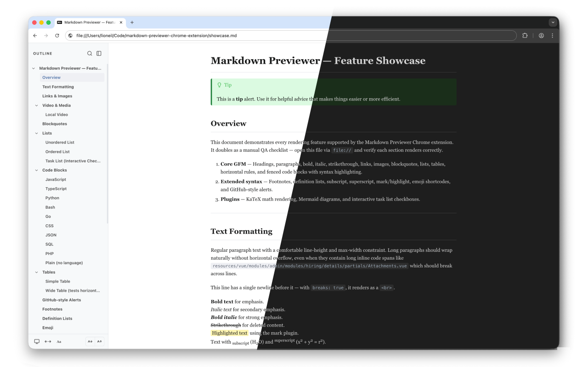

# Markdown Previewer



A Chrome (and Chromium derivatives) extension that renders local `.md` files beautifully — right in the browser.

Open any markdown file via `file://` and get GitHub-style rendering with a navigable outline, Mermaid diagrams, syntax highlighting, interactive checkboxes, and dark mode.

## Features

### Markdown Rendering

Full **GitHub Flavored Markdown** support powered by markdown-it, plus:

- **Syntax-highlighted code blocks** — 20+ languages with automatic detection, language labels, and one-click copy
- **Mermaid diagrams** — flowcharts, sequence diagrams, Gantt charts, and more rendered inline as SVG
- **Math / LaTeX** — KaTeX rendering for inline and block equations
- **Task lists** — interactive checkboxes you can toggle and save (see below)
- **Tables** — full GFM tables with colspan, rowspan, and multi-line cell support
- **Footnotes** — numbered references with back-links
- **GitHub-style alerts** — `[!NOTE]`, `[!TIP]`, `[!IMPORTANT]`, `[!WARNING]`, `[!CAUTION]`
- **Emoji shortcodes** — `:rocket:` becomes :rocket:
- **Subscript / Superscript** — `H~2~O` and `x^2^`
- **Highlighted text** — `==marked==`
- **Definition lists** — term/definition pairs

### Interactive Checkboxes

Click a checkbox in the rendered preview to toggle it. A floating save bar appears so you can download the updated file with your changes preserved. No editor needed.

### Sidebar Outline

A collapsible sidebar shows the full heading hierarchy of the document:

- **Hierarchical tree** with collapsible sections
- **Fuzzy search** to filter headings instantly
- **Scroll spy** highlights the current section as you read
- **Keyboard navigation** through search results

### Theming

- **Auto / Light / Dark** modes
- Detects system preference automatically
- Smooth transitions between themes
- Theme persists across sessions

### UI Controls

The sidebar toolbar provides quick access to:

- **Theme toggle** — cycle through auto, light, and dark
- **Wide mode** — expand content beyond the default 800px max-width
- **Font size** — 5 preset sizes from 14px to 20px
- **Back-to-top** button appears when scrolled down

### Keyboard Shortcuts

| Shortcut | Action |
|---|---|
| `Alt+Shift+T` | Toggle theme (auto / light / dark) |
| `Ctrl+Shift+K` | Toggle sidebar |
| `Ctrl+Shift+F` | Search outline |
| `Ctrl+Shift+W` | Toggle wide mode |
| `Ctrl+Shift+=` | Increase font size |
| `Ctrl+Shift+-` | Decrease font size |

### Extension Popup

Click the toolbar icon to access settings:

- Enable/disable the previewer
- Toggle individual plugins on or off (Mermaid, KaTeX, emoji, footnotes, alerts, and more)
- Toggle all plugins at once
- Reset to defaults

## Installation

### From Source

```bash
# Clone the repository
git clone https://github.com/lioneil/markdown-previewer-chrome-extension.git
cd markdown-previewer-chrome-extension

# Install dependencies
npm install

# Build for production
npm run package
```

Then load the extension:

1. Open `chrome://extensions` in Chrome or Brave
2. Enable **Developer mode**
3. Click **Load unpacked** and select the `.output/chrome-mv3` directory
4. Go to the extension's details and enable **Allow access to file URLs**
5. Open any local `.md` file to see it rendered

### Development

```bash
# Start dev server with hot reload
npm run dev

# Type check
npm run lint

# Build production zip
npm run package
```

## How It Works

The extension injects a content script into `file://` URLs matching `.md` and `.markdown` extensions. It reads the raw text content, parses it through markdown-it with all configured plugins, and replaces the page with the rendered output — styled, themed, and ready to read.

Settings and preferences are stored in `chrome.storage.sync`, so they follow you across devices where you're signed into Chrome.

## Permissions

- **Storage** — persist theme, plugin settings, and UI preferences
- **Downloads** — save modified files when checkboxes are toggled

## Built With

- [WXT](https://wxt.dev/) — Vite-based browser extension framework
- [markdown-it](https://github.com/markdown-it/markdown-it) — Markdown parser
- [highlight.js](https://highlightjs.org/) — Syntax highlighting
- [Mermaid](https://mermaid.js.org/) — Diagram rendering
- [KaTeX](https://katex.org/) — Math typesetting

## License

MIT
