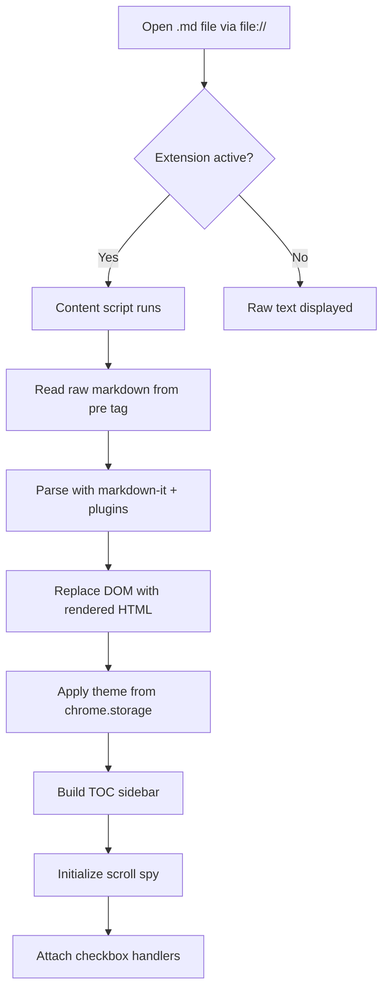
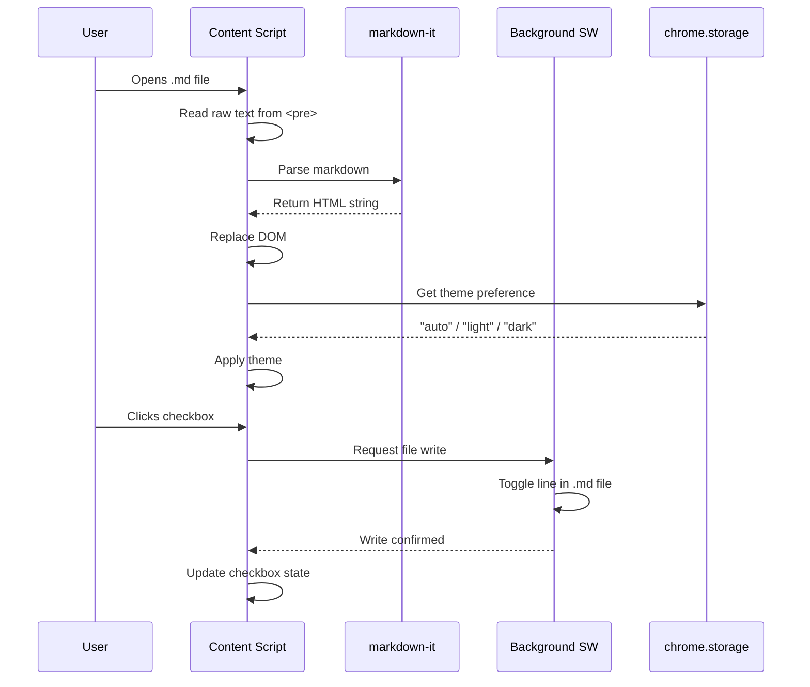
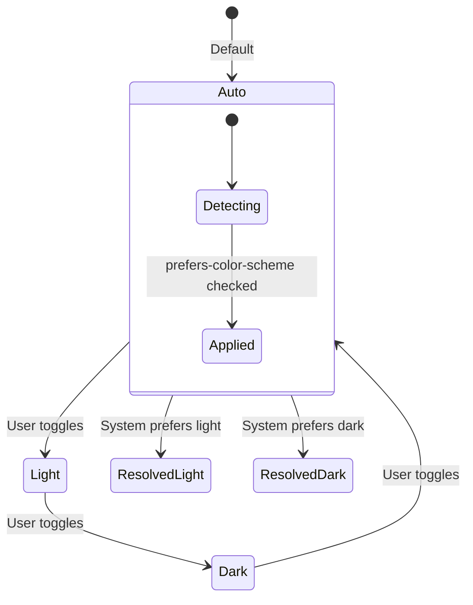
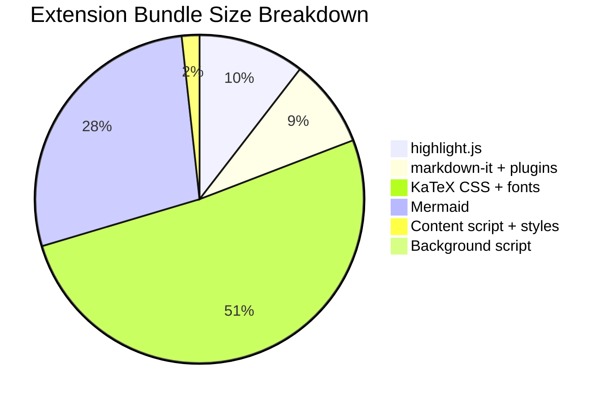
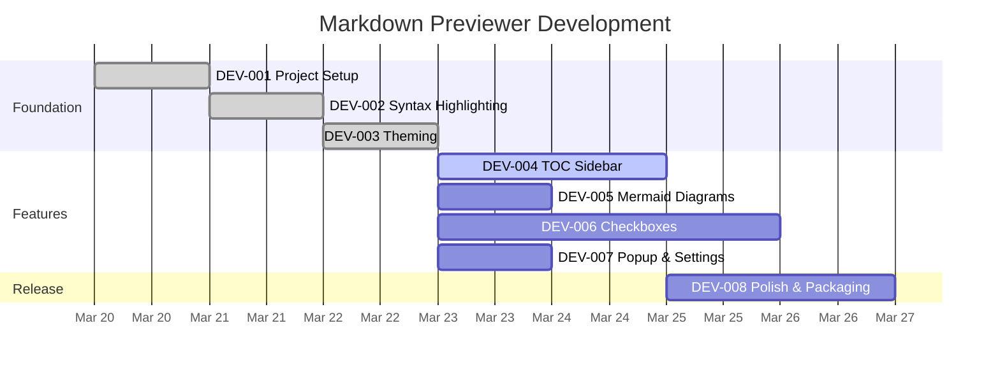

# Markdown Previewer — Feature Showcase

> [!TIP]
> This is a **tip** alert. Use it for helpful advice that makes things easier or more efficient.

## Overview

This document demonstrates every rendering feature supported by the Markdown Previewer Chrome extension. It doubles as a manual QA checklist — open this file via `file://` and verify each section renders correctly.

1. **Core GFM** — Headings, paragraphs, bold, italic, strikethrough, links, images, blockquotes, lists, tables, horizontal rules, and fenced code blocks with syntax highlighting.
2. **Extended syntax** — Footnotes, definition lists, subscript, superscript, mark/highlight, emoji shortcodes, and GitHub-style alerts.
3. **Plugins** — KaTeX math rendering, Mermaid diagrams, and interactive task list checkboxes.

---

## Text Formatting

Regular paragraph text with a comfortable line-height and max-width constraint. Long paragraphs should wrap naturally without horizontal overflow, even when they contain long inline code spans like `resources/vue/modules/admin/modules/hiring/details/partials/Attachments.vue` which should break across lines.

This line has a single newline before it — with `breaks: true`, it renders as a `<br>`.

**Bold text** for emphasis.
*Italic text* for secondary emphasis.
***Bold italic*** for strong emphasis.
~~Strikethrough~~ for deleted content.
==Highlighted text== using the mark plugin.
Text with ~subscript~ (H~2~O) and ^superscript^ (x^2^ + y^2^ = r^2^).

---

## Links & Images

- Inline link: [GitHub](https://github.com)
- Auto-linked URL: https://example.com
- Reference-style link: [Markdown Guide][md-guide]

[md-guide]: https://www.markdownguide.org "Markdown Guide"

Image with alt text (if the file exists):


---

## Video & Media

### Local Video

<video src="../sample.mov" controls width="100%">
  Your browser does not support the video tag.
</video>

---

## Blockquotes

> This is a simple blockquote. It should have a left border and muted text color.

> **Nested blockquote with formatting:**
>
> > Inner blockquote with `inline code` and a [link](https://example.com).
> >
> > Multiple paragraphs inside the nested blockquote.
>
> Back to the outer level.

---

## Lists

### Unordered List

- First item
- Second item with **bold** and `code`
  - Nested item A
  - Nested item B
    - Deeply nested item
- Third item

### Ordered List

1. Clone the repository
2. Install dependencies: `npm install`
3. Start the dev server: `npm run dev`
4. Load the extension in Chrome:
   1. Open `chrome://extensions`
   2. Enable "Developer mode"
   3. Click "Load unpacked"
   4. Select `.output/chrome-mv3`
5. Enable "Allow access to file URLs"

### Task List (Interactive Checkboxes)

- [x] Project setup with WXT framework
- [x] Markdown-it with all plugins configured
- [x] Syntax highlighting via highlight.js
- [x] Base stylesheet per Styleguide
- [x] Light/dark theme with auto-detection
- [x] TOC sidebar with scroll spy
- [x] Mermaid diagram rendering
- [ ] Interactive checkboxes that save to file
- [ ] Extension popup & settings
- [ ] Polish, edge cases & packaging

---

## Code Blocks

### JavaScript

```javascript
async function fetchMarkdown(url) {
  const response = await fetch(url);
  if (!response.ok) {
    throw new Error(`Failed to fetch: ${response.status}`);
  }
  return response.text();
}

// Render markdown to HTML
const md = new MarkdownIt({ breaks: true, linkify: true });
const html = md.render(await fetchMarkdown('README.md'));
document.body.innerHTML = html;
```

### TypeScript

```typescript
interface ThemeConfig {
  preference: 'auto' | 'light' | 'dark';
  resolved: 'light' | 'dark';
}

function resolveTheme(pref: ThemeConfig['preference']): ThemeConfig['resolved'] {
  if (pref === 'auto') {
    return window.matchMedia('(prefers-color-scheme: dark)').matches ? 'dark' : 'light';
  }
  return pref;
}
```

### Python

```python
from pathlib import Path
import re

def count_checkboxes(markdown: str) -> dict[str, int]:
    """Count checked and unchecked checkboxes in markdown text."""
    lines = markdown.splitlines()
    checked = sum(1 for l in lines if re.match(r'\s*-\s*\[x\]', l, re.I))
    unchecked = sum(1 for l in lines if re.match(r'\s*-\s*\[ \]', l))
    return {"checked": checked, "unchecked": unchecked, "total": checked + unchecked}

if __name__ == "__main__":
    content = Path("README.md").read_text()
    stats = count_checkboxes(content)
    print(f"Progress: {stats['checked']}/{stats['total']} tasks complete")
```

### Bash

```bash
#!/bin/bash
set -euo pipefail

# Build and package the extension
echo "Building extension..."
npx wxt build

echo "Packaging..."
cd .output/chrome-mv3
zip -r ../../markdown-previewer.zip .
cd ../..

echo "Done: markdown-previewer.zip ($(du -h markdown-previewer.zip | cut -f1))"
```

### Go

```go
package main

import (
    "fmt"
    "os"
    "path/filepath"
    "strings"
)

func findMarkdownFiles(root string) ([]string, error) {
    var files []string
    err := filepath.Walk(root, func(path string, info os.FileInfo, err error) error {
        if err != nil {
            return err
        }
        ext := strings.ToLower(filepath.Ext(path))
        if ext == ".md" || ext == ".markdown" {
            files = append(files, path)
        }
        return nil
    })
    return files, err
}

func main() {
    files, err := findMarkdownFiles(".")
    if err != nil {
        fmt.Fprintf(os.Stderr, "Error: %v\n", err)
        os.Exit(1)
    }
    for _, f := range files {
        fmt.Println(f)
    }
}
```

### CSS

```css
[data-theme="dark"] {
  --color-bg: #1E1E1E;
  --color-text: #D4D4D4;
  --color-link: #6CA4E0;
  --color-code-bg: #2D2D2D;
  --color-divider: #3E3E3E;
}

.md-body pre.code-block {
  position: relative;
  padding-top: 36px;
}
```

### JSON

```json
{
  "manifest_version": 3,
  "name": "Markdown Previewer",
  "version": "1.0.0",
  "permissions": ["storage"],
  "content_scripts": [{
    "matches": ["file:///*/*.md"],
    "js": ["content-scripts/content.js"],
    "css": ["content-scripts/content.css"],
    "run_at": "document_idle"
  }]
}
```

### SQL

```sql
SELECT
    h.id AS hiring_id,
    u.email AS professional_email,
    h.status,
    COUNT(ra.media_id) AS attachments_with_media
FROM hirings h
JOIN users u ON u.id = h.professional_user_id
CROSS JOIN LATERAL jsonb_array_elements(h.requested_attachments) AS ra
WHERE h.deleted_at IS NULL
GROUP BY h.id, u.email, h.status
HAVING COUNT(ra.media_id) > 0
ORDER BY h.created_at DESC
LIMIT 20;
```

### PHP

```php
class CleanupHiringDocumentsJob implements ShouldQueue
{
    use Dispatchable, InteractsWithQueue, Queueable, SerializesModels;

    public function __construct(
        private readonly Hiring $hiring,
    ) {}

    public function handle(): void
    {
        $this->hiring->deleteHiringDocumentsFromStorage();

        Log::info('Hiring documents cleaned up', [
            'hiring_id' => $this->hiring->id,
            'attachments' => count($this->hiring->requested_attachments ?? []),
        ]);
    }
}
```

### Plain (no language)

```
This is a plain code block with no language annotation.
It should render as monospace text without syntax highlighting.
The background should still be the code-block color.
```

---

## Tables

### Simple Table

| Feature | Status | Ticket |
|---------|--------|--------|
| GFM Rendering | Done | DEV-001 |
| Syntax Highlighting | Done | DEV-002 |
| Light/Dark Theme | Done | DEV-003 |
| TOC Sidebar | Pending | DEV-004 |
| Mermaid Diagrams | Pending | DEV-005 |
| Interactive Checkboxes | Pending | DEV-006 |

### Wide Table (tests horizontal scroll)

| Component | File Path | Purpose | Layer | Status | Priority | Assignee | Sprint | Notes |
|-----------|-----------|---------|-------|--------|----------|----------|--------|-------|
| Content Script | `entrypoints/content.ts` | Main entry, reads raw text, renders markdown | Extension | Done | Critical | — | 1 | Runs at document_idle |
| Markdown Renderer | `lib/markdown.ts` | Configures markdown-it with all plugins | Library | Done | Critical | — | 1 | 13 plugins registered |
| Theme Manager | `lib/theme.ts` | Theme detection, toggling, persistence | Library | Done | High | — | 1 | Auto/light/dark cycle |
| Sidebar Builder | `lib/sidebar.ts` | TOC extraction, scroll spy, collapse | Library | Pending | High | — | 2 | IntersectionObserver |
| Checkbox Persistence | `lib/checkbox.ts` | Maps checkboxes to source lines, writes back | Library | Pending | Critical | — | 3 | Needs Native Messaging |

---

## GitHub-style Alerts

> [!NOTE]
> This is a **note** alert. Use it to highlight information that users should take into account, even when skimming. Supports `inline code` and [links](https://example.com).

> [!TIP]
> This is a **tip** alert. Use it for helpful advice that makes things easier or more efficient.

> [!IMPORTANT]
> This is an **important** alert. Use it for crucial information necessary for users to succeed.

> [!WARNING]
> This is a **warning** alert. Use it for urgent information that needs immediate user attention to avoid problems.

> [!CAUTION]
> This is a **caution** alert. Use it to advise about risks or negative outcomes of certain actions.

---

## Footnotes

The Markdown Previewer extension uses markdown-it[^1] as its core parser, with highlight.js[^2] for syntax highlighting. The extension architecture follows Chrome's Manifest V3[^3] requirements.

Interactive checkboxes that persist to the source file[^4] are the primary motivation for this project.

[^1]: [markdown-it](https://github.com/markdown-it/markdown-it) — A fast, pluggable markdown parser written in JavaScript. Used by md-reader and many other tools.

[^2]: [highlight.js](https://highlightjs.org/) — Syntax highlighting for the web. Supports 190+ languages with automatic detection.

[^3]: Manifest V3 imposes constraints like no remote code execution, event-driven service workers instead of persistent background pages, and `declarativeNetRequest` instead of `webRequestBlocking`.

[^4]: This requires either a Native Messaging host or the File System Access API, since Chrome extensions cannot write to the local filesystem directly.

---

## Definition Lists

Markdown-it
:   A fast, pluggable markdown parser written in JavaScript. The core rendering engine used by this extension.

WXT
:   A next-generation framework for building web extensions with Vite. Provides file-based entrypoints, auto-imports, and cross-browser builds.

Content Script
:   A JavaScript file that runs in the context of a web page. In this extension, it reads raw `.md` text and replaces the DOM with rendered HTML.

Service Worker
:   The background script in Manifest V3 extensions. Event-driven and terminates when idle — state must be persisted via `chrome.storage`.

Native Messaging
:   A Chrome API that allows extensions to communicate with a companion native application installed on the user's machine. Required for filesystem write access.

---

## Emoji

Commonly used in markdown documentation:

:rocket: Launch ready
:white_check_mark: Tests passing
:warning: Needs attention
:bug: Known issue
:sparkles: New feature
:wrench: Configuration
:memo: Documentation
:fire: Breaking change
:tada: Release
:construction: Work in progress

---

## Typographer (Smart Quotes & Dashes)

The typographer plugin converts ASCII punctuation into typographically correct characters. It can be toggled on/off in the extension popup settings.

### Smart Quotes

- "Double quotes" should become curly: "Double quotes"
- 'Single quotes' should become curly: 'Single quotes'
- "Nested 'quotes' inside" doubles work too.

### Dashes

- Double dash -- becomes an en-dash (–)
- Triple dash --- becomes an em-dash (—)
- She said -- quite firmly --- "No."

### Ellipsis

- Three dots... become a proper ellipsis (…)
- Wait for it...

### Other Replacements

- (c) becomes the copyright symbol
- (r) becomes the registered trademark symbol
- (tm) becomes the trademark symbol
- (p) becomes the section symbol
- +- becomes the plus-minus sign

---

## Math (KaTeX)

### Inline Math

The quadratic formula is $x = \frac{-b \pm \sqrt{b^2 - 4ac}}{2a}$, where $a \neq 0$.

Einstein's mass-energy equivalence: $E = mc^2$.

### Block Math

The probability density function of a normal distribution:

$$
f(x) = \frac{1}{\sigma\sqrt{2\pi}} \exp\left(-\frac{(x - \mu)^2}{2\sigma^2}\right)
$$

Matrix multiplication:

$$
\begin{bmatrix}
a_{11} & a_{12} \\
a_{21} & a_{22}
\end{bmatrix}
\begin{bmatrix}
b_{11} & b_{12} \\
b_{21} & b_{22}
\end{bmatrix}
=
\begin{bmatrix}
a_{11}b_{11} + a_{12}b_{21} & a_{11}b_{12} + a_{12}b_{22} \\
a_{21}b_{11} + a_{22}b_{21} & a_{21}b_{12} + a_{22}b_{22}
\end{bmatrix}
$$

Euler's identity:

$$e^{i\pi} + 1 = 0$$

---

## Mermaid Diagrams

### Flowchart



### Sequence Diagram



### State Diagram



### Pie Chart



### Gantt Chart



---

## Horizontal Rules

The three ways to create horizontal rules all render the same:

---

***

___

---

## Nested & Complex Content

### Blockquote with Code and List

> **Setup Instructions:**
>
> 1. Install dependencies:
>    ```bash
>    npm install
>    ```
> 2. Start dev server:
>    ```bash
>    npm run dev
>    ```
> 3. Load in Chrome and test with this file.

### Table Inside Alert

> [!NOTE]
> Current plugin status:
>
> | Plugin | Version | Status |
> |--------|---------|--------|
> | markdown-it | 14.1.1 | Active |
> | highlight.js | 11.11.1 | Active |
> | mermaid | 11.13.0 | Active |
> | katex | 0.16.39 | Active |

### List with Mixed Content

1. **Phase 1**: Setup
   - Initialize WXT project
   - Configure TypeScript
   - Result: `npm run build` produces valid extension

2. **Phase 2**: Core rendering
   > All plugins must be registered before the first `md.render()` call.

   ```typescript
   const md = createMarkdownRenderer();
   const html = md.render(rawMarkdown);
   ```

3. **Phase 3**: Testing
   - [ ] Open `test-fixtures/showcase.md` via `file://`
   - [ ] Verify all sections render correctly
   - [ ] Test in both light and dark themes

---

## Regression Checklist

- [x] All headings render with correct sizes and border-bottom
- [ ] Bold, italic, strikethrough, mark, sub, sup all display correctly
- [ ] Inline code has background color and breaks on long strings
- [ ] Code blocks have syntax highlighting and copy button
- [ ] Language label shows in top-left of code blocks
- [ ] Copy button appears on hover and shows check icon after click
- [ ] Tables are scrollable horizontally when they overflow
- [ ] Alerts render with correct border colors and backgrounds
- [ ] Footnotes link bidirectionally (click to footnote, click back to reference)
- [ ] Emoji shortcodes render as emoji characters
- [ ] KaTeX math renders inline and as block equations
- [ ] Mermaid diagrams render as SVG (when implemented)
- [ ] Task list checkboxes are visible and styled
- [ ] Theme toggle works: auto → light → dark → auto
- [ ] Dark theme applies to all elements including code blocks and alerts
- [ ] Page title is set from the first H1
- [ ] No FOUC — raw markdown is hidden until rendering completes
- [ ] No console errors
